# ha-assist-card

[](https://www.home-assistant.io/integrations/marketplace/)
[](https://github.com/juju35/ha-assist-card/actions/workflows/hacs.yml)
[](https://github.com/juju35/ha-assist-card/actions/workflows/validate.yml)
[](https://github.com/juju35/ha-assist-card/actions/workflows/lint.yml)
[](https://github.com/juju35/ha-assist-card/releases/latest)
[](https://github.com/juju35/ha-assist-card/blob/main/LICENSE)
[](https://buymeacoffee.com/julienstep9)

<p align="center"></p>

<p align="center">
  &nbsp;&nbsp;
  &nbsp;&nbsp;
  &nbsp;&nbsp;
  
</p>

Lovelace cards for Home Assistant to **chat with Assist** from a dashboard: type or say a request, read the answer as it is written, follow up in the same conversation. They talk to an **Assist pipeline** — the built-in Home Assistant agent or any **AI conversation agent** (Google Generative AI, OpenAI, Anthropic, Ollama…) — with the pipeline's own speech-to-text for the microphone and, if you want, its text-to-speech to read the answers aloud.

A full **chat card** with bubbles, streamed answers, the tools the agent called and suggestion chips, and a **voice-first mini card**: one big microphone button, the last question and its answer, unfolding to the full chat.

[](https://my.home-assistant.io/redirect/marketplace_repository/?owner=juju35&repository=ha-assist-card&category=plugin)

| Assist Card | Assist Mini Card |
|---|---|
| 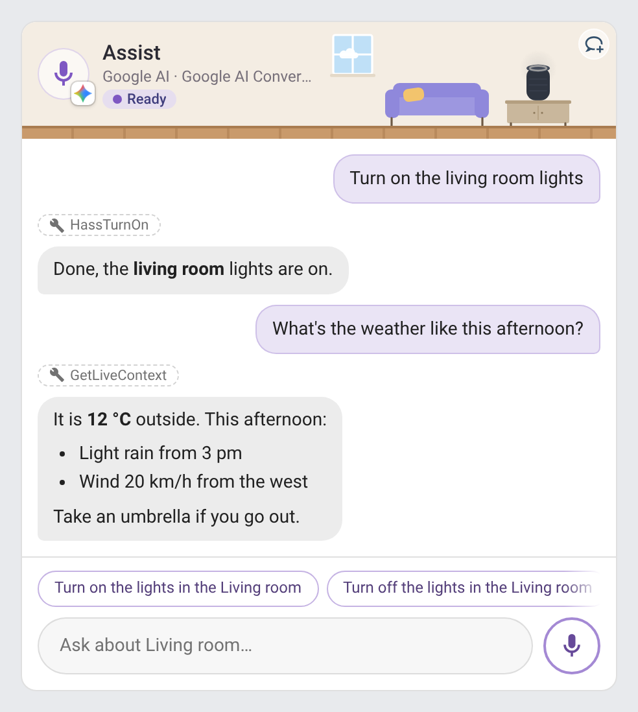 | 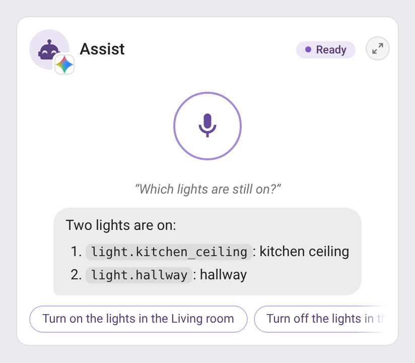 |

## Features

- Two cards: a full **Assist Card** (`custom:assist-card`) and a voice-first **Assist Mini Card** (`custom:assist-mini-card`)
- Chat bubbles — your requests on the right, tinted violet; the answers on the left — with a typing indicator while the agent thinks and the answer **streamed** word by word with a caret as an AI agent writes it (see [Animations](#animations))
- The **tools** an AI agent called (turning on a light, reading the live context…) shown above its answer
- Answers rendered as safe **markdown-lite**: paragraphs, bold, italic, inline code and code blocks, lists, headings and `http(s)` links; everything else is shown as text (no HTML from the agent ever reaches the page)
- The **conversation** is kept while the card lives, so follow-ups ("and in the kitchen?") work; the **new conversation** button at the top right starts over
- **Microphone**: a large round button next to the text field records your voice in the browser and sends it to the pipeline's speech-to-text; its ring pulses while it listens and it stops on its own when you stop speaking. It turns into a send button as soon as you type
- **Spoken answers** (`speak: true`) through the pipeline's text-to-speech
- **Suggestion chips** above the text field: your own list (`suggestions`), or a few requests about the card's **area** (`area`), which is also given as context to AI agents ("In the Living room: is it warm enough?")
- Any **pipeline** (the preferred one by default) or any **conversation agent** directly (`agent_id`)
- **Illustrated header** (90 px, full and mini card): a living room with a smart speaker on a sideboard and a parquet floor strip; the speaker shows the state — its light ring breathing when ready, sound waves coming in and a voice level in a speech bubble while it **listens**, a spinning ring and thinking dots while it **transcribes or thinks**, sound waves going out while it **speaks**, a « ! » and a shake on an **error**, its light off when **unavailable**. A night version shows with a dark Home Assistant theme (a light theme keeps the day one after sunset), forced with `illustration_theme`; `illustration: false` brings back the classic header
- Header: a round microphone icon in the color of the status (click it for the agent's more-info dialog) with the agent's integration logo on it, the title, the status (ready, listening, transcribing, thinking, speaking, error, unavailable) and the pipeline and agent as subtitle. In the classic header the chatbot icon, also in the status color, and the logo small before the agent's name
- **Mini card**: a big centred microphone, the last question in quotes and the last answer under it, the suggestion chips; its detail button (top right) unfolds the full chat, and a click anywhere else folds it back. Without a microphone (no speech-to-text in the pipeline, `voice: false`, a page not served over HTTPS) it shows a text field instead
- Visual editor in the dashboard UI for both cards
- Sections view: the full card takes 12 columns by default and at least 6, the mini card 6
- Light and dark mode, `prefers-reduced-motion`, English, French, German, Spanish, Italian, Dutch, European Portuguese, Polish, Serbian (Cyrillic and Latin), Romanian, Danish, Swedish, Bulgarian, Russian, Ukrainian, Hungarian, Slovak, Czech, Slovenian, Latvian and Greek
- Single file, no external dependency (the agents' logos come from the Home Assistant brands service, like in Home Assistant itself)

## Supported integrations

Any conversation agent of Home Assistant works, through an Assist pipeline or directly:

| Agent | Notes |
|---|---|
|  [Home Assistant](https://www.home-assistant.io/integrations/conversation/) (built-in, `conversation.home_assistant`) | Set sentences: the area is not added to the request, the answer comes at once |
|  [Google Generative AI](https://www.home-assistant.io/integrations/google_generative_ai_conversation/) | Streamed answers and tools through a pipeline |
|  [OpenAI](https://www.home-assistant.io/integrations/openai_conversation/) | Streamed answers and tools through a pipeline |
|  [Anthropic](https://www.home-assistant.io/integrations/anthropic/) | Streamed answers and tools through a pipeline |
|  [Ollama](https://www.home-assistant.io/integrations/ollama/) | Streamed answers and tools through a pipeline |
| Other agents (Extended OpenAI Conversation, OpenRouter, custom agents…) | Whatever the agent supports: streamed when it streams |

The microphone uses the speech-to-text of the pipeline (Home Assistant Cloud, Whisper, Google AI…) and the spoken answers its text-to-speech (Piper, Home Assistant Cloud, Google AI…): set them up in **Settings → Voice assistants**.

## Prerequisites

Home Assistant 2025.6 or later, with at least one Assist pipeline (Home Assistant creates one). The microphone needs the dashboard to be opened over **HTTPS** (or on `localhost`, as browsers only give the microphone to secure pages) and a pipeline with a speech-to-text engine.

## Installation

### Via the Marketplace (recommended)

Click the button below to add the repository directly:

[](https://my.home-assistant.io/redirect/marketplace_repository/?owner=juju35&repository=ha-assist-card&category=plugin)

Then click **Install**, and reload your browser when the Marketplace asks you to.

Or manually:

1. Open **Settings → Marketplace → Add from link** (top right; this needs a GitHub account connected)
2. Add `https://github.com/juju35/ha-assist-card` — Type: **Dashboard**
3. Open **Assist Card** and click **Install**
4. Clear your browser cache and refresh

The Marketplace adds the resource `/local/community/ha-assist-card/assist-card.js` for you.

### Manual

1. Download `assist-card.js` and the `assist-card.i18n.*.js` translation files from the [latest release](https://github.com/juju35/ha-assist-card/releases/latest)
2. Copy them all to `/config/www/` (without the translation files, the cards show in English)
3. Go to **Settings → Dashboards → ⋮ → Resources** → Add resource:
   - URL: `/local/assist-card.js`
   - Type: **JavaScript Module**
4. Clear your browser cache and refresh

## Configuration

### Card types

| Card | Type |
|---|---|
| Assist Card | `custom:assist-card` |
| Assist Mini Card | `custom:assist-mini-card` |

### Visual editor

Edit a dashboard, click **Add card** and search for **Assist Card** or **Assist Mini Card**. Pick a pipeline (the preferred one by default) or a conversation agent, an optional title and area, and the options; the preview updates live, and options left at their default are kept out of the generated YAML. The suggestion list is set in YAML only.

### Minimal

```yaml
type: custom:assist-card
```

```yaml
type: custom:assist-mini-card
```

### Full options

```yaml
type: custom:assist-card
pipeline: 01jgoogleai
title: Living room
area: living_room
area_context: true
show_suggestions: true
suggestions:
  - Turn on the lights
  - What's the weather like this afternoon?
  - Good night
voice: true
speak: false
height: 400
show_title: true
show_subtitle: true
illustration: true
illustration_theme: auto
language: fr
```

```yaml
type: custom:assist-mini-card
agent_id: conversation.google_ai_conversation
area: kitchen
speak: true
zoom: true
```

### Options reference

| Option | Card | Default | Description |
|---|---|---|---|
| `pipeline` | both | `preferred` | Assist pipeline used for the conversation, the microphone and the spoken answers: its id (set by the visual editor), or `preferred` for the one marked preferred in **Settings → Voice assistants** |
| `agent_id` | both | — | Conversation agent to talk to directly (`conversation.*` entity, or `homeassistant` for the built-in one) instead of the pipeline's; its answers come in one piece (`conversation/process` does not stream). The pipeline still gives the microphone and the spoken answers |
| `title` | both | `Assist` | Card title |
| `show_title` | both | `true` | Show the title in the header |
| `show_subtitle` | both | `true` | Show the pipeline and agent names under the title (full card) |
| `illustration` | both | `true` | Animated illustrated header (a living room with a smart speaker showing the state). `false` shows the classic header |
| `illustration_theme` | both | `auto` | `auto` (follows the Home Assistant theme: night with a dark theme, day with a light theme), `day` or `night` |
| `area` | both | — | Area id: default suggestions about it, and the area given as context to AI agents |
| `area_context` | both | `true` | Prefix typed and spoken requests with the area for AI agents ("In the Kitchen: …"). The built-in agent never gets it, as it matches set sentences |
| `show_suggestions` | both | `true` | Show the suggestion chips |
| `suggestions` | both | Area requests | List of texts sent as they are when their chip is clicked (YAML only). Without it, a few requests about `area` (none without an area) |
| `voice` | both | `true` | Microphone button (shown only when the pipeline has speech-to-text and the browser a microphone) |
| `speak` | both | `false` | Read the answers aloud with the pipeline's text-to-speech |
| `height` | both | `360` | Maximum height of the chat, in pixels (160 to 1200): it grows with the conversation, then scrolls; the mini card uses it in its unfolded view |
| `zoom` | mini | `true` | Detail button at the top right of the mini card: it unfolds the full chat (with the same options) and switches back; a click outside the card also folds it. `false` removes the button |
| `language` | both | Auto | Force language: `en`, `fr`, `de`, `es`, `it`, `nl`, `pt`, `pl`, `sr`, `sr-Latn`, `ro`, `da`, `sv`, `bg`, `ru`, `uk`, `hu`, `sk`, `cs`, `sl`, `lv` or `el` (auto-detects from HA settings). It changes the card's texts, not the language Assist answers in (the pipeline's) |

## Screenshots

### Animations

Both animations honour `prefers-reduced-motion`.

Listening: the microphone ring of the mini card pulses outwards while it records, and the status chip reads **Listening…**:

| Light | Dark |
|---|---|
| 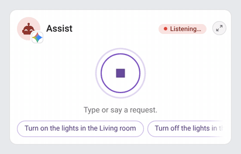 | 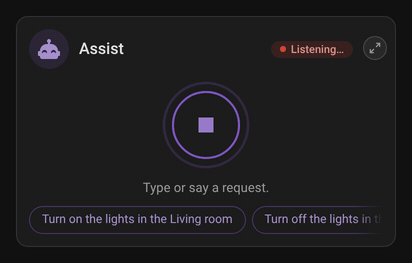 |

Streaming: the typing dots while an AI agent thinks, then its answer written as it streams in, a caret at its end, the markdown laid out on the fly:

| Dark | Light |
|---|---|
| 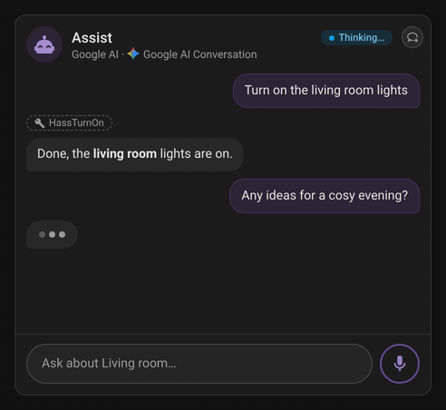 | 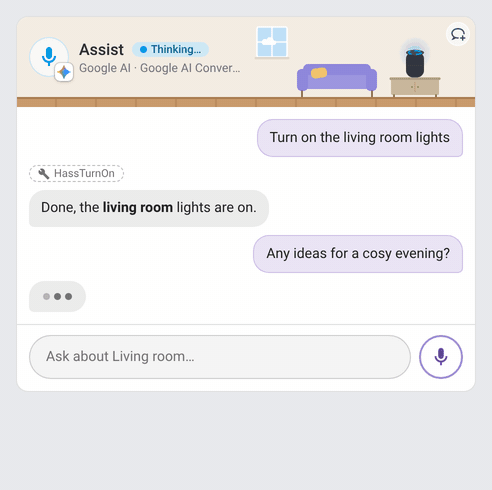 |

### Cards

A conversation with an AI agent (Google Generative AI) in the living room: the tools it called, a markdown answer, the area's suggestions above the text field:

| Light | Dark |
|---|---|
|  | 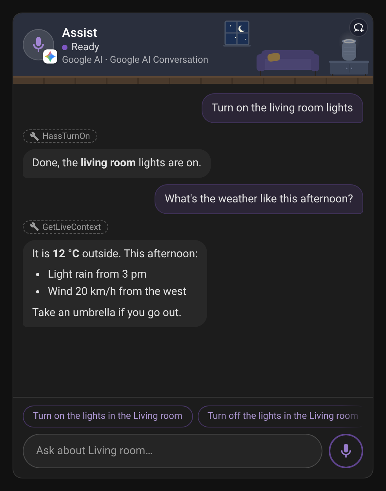 |

An empty chat, and the built-in Home Assistant agent with suggestions of one's own and an error answer:

| | Empty chat | Built-in agent |
|---|---|---|
| Dark | 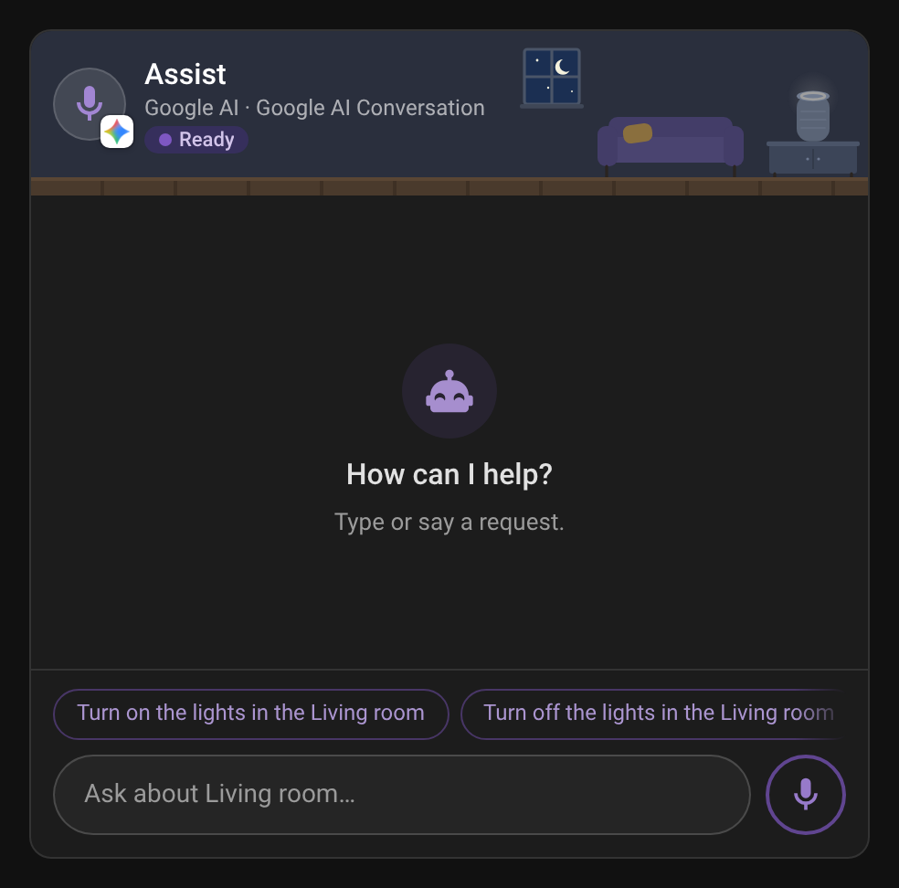 | 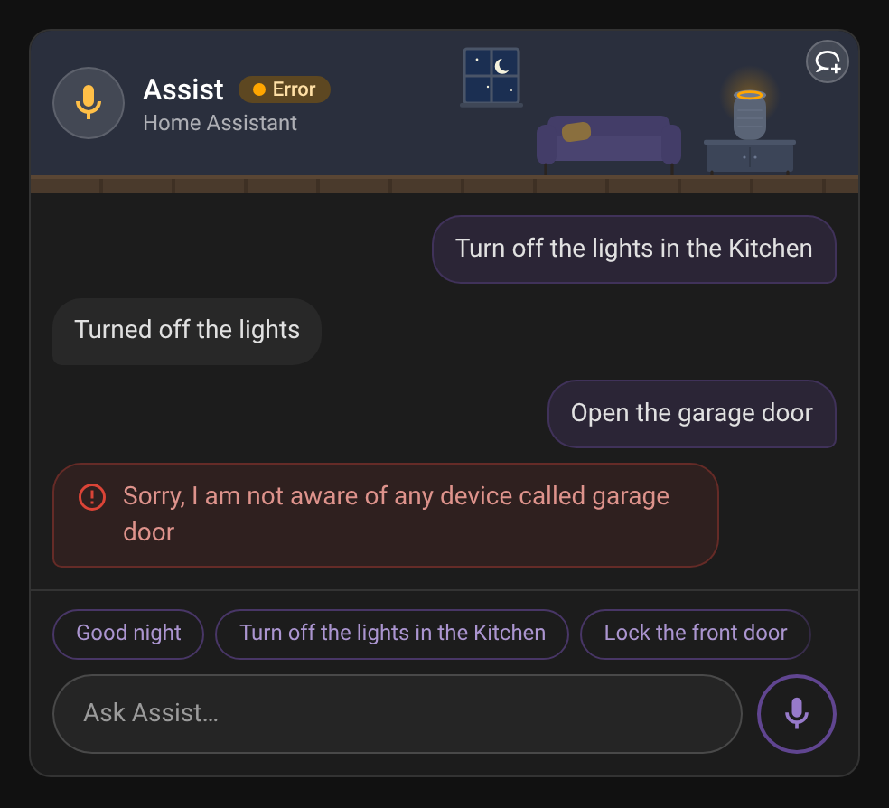 |
| Light | 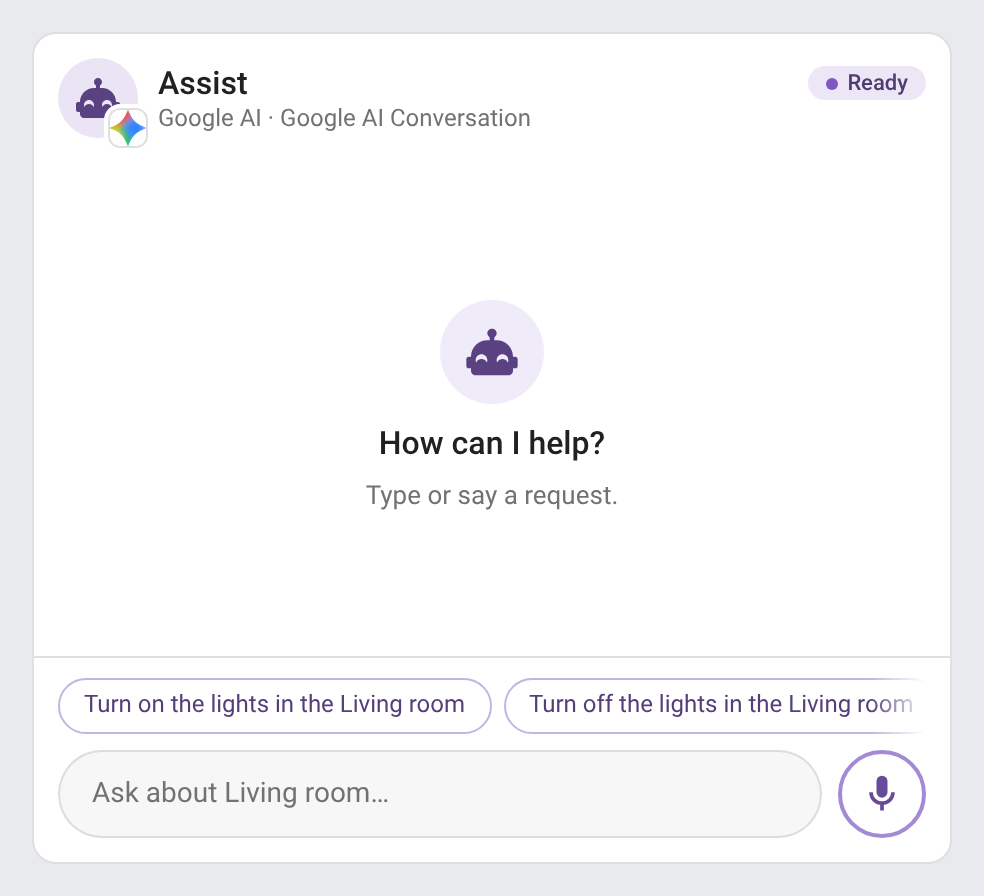 | 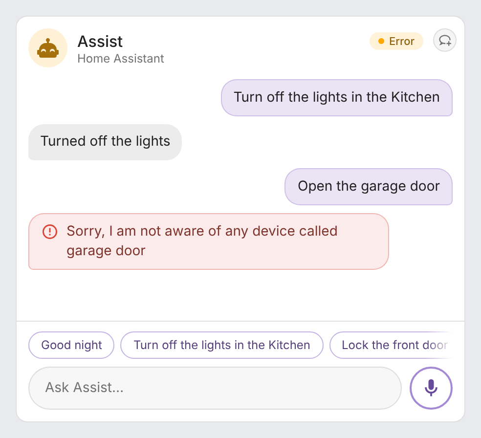 |

The mini card, before and after a question:

| | Before | After a question |
|---|---|---|
| Light | 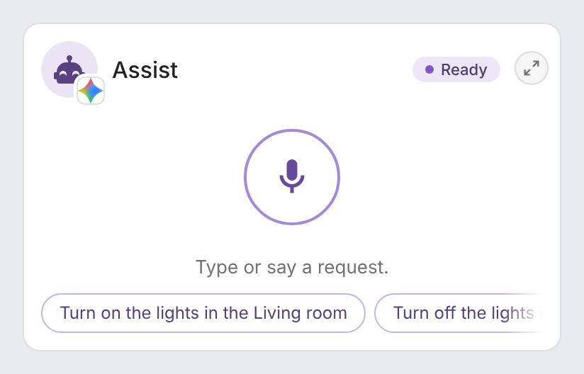 |  |
| Dark | 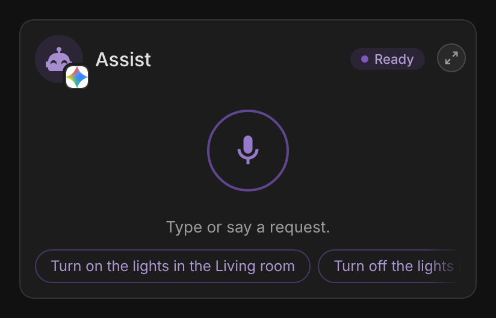 | 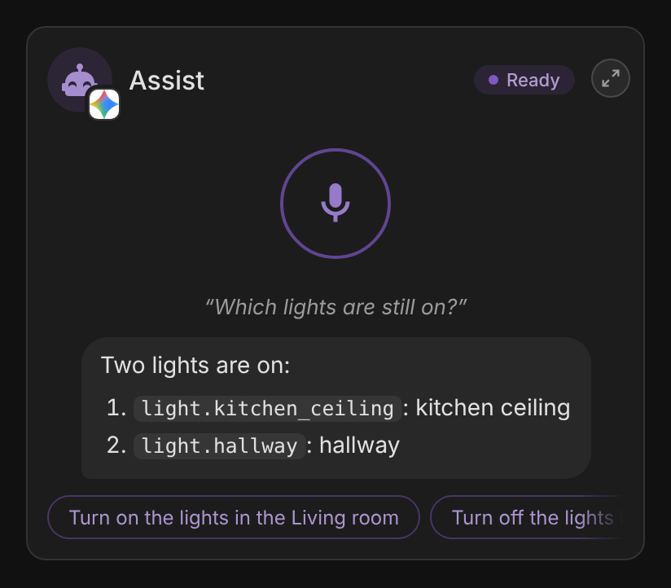 |

The mini card unfolded by its detail button:

| Light | Dark |
|---|---|
| 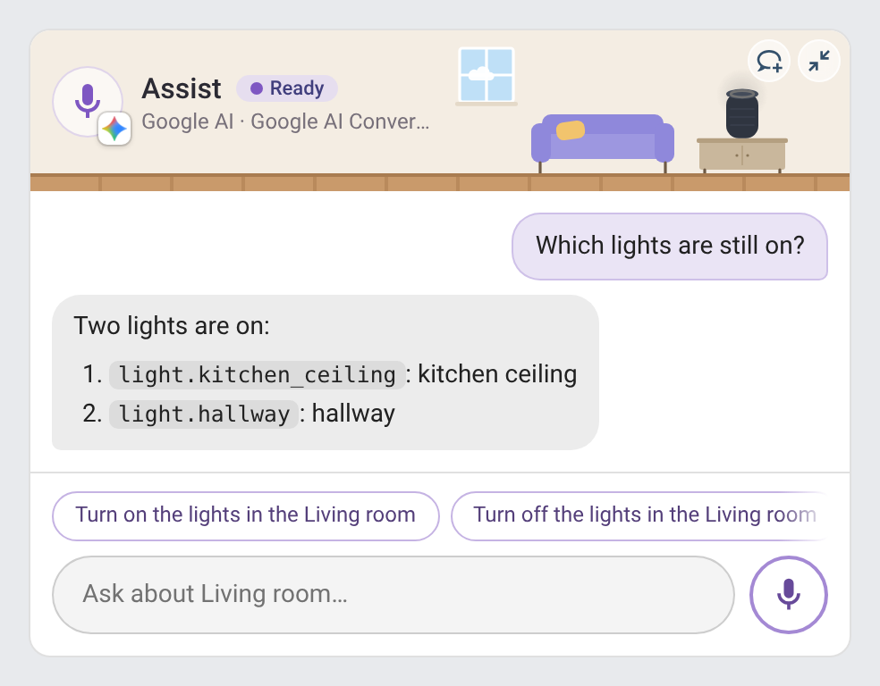 | 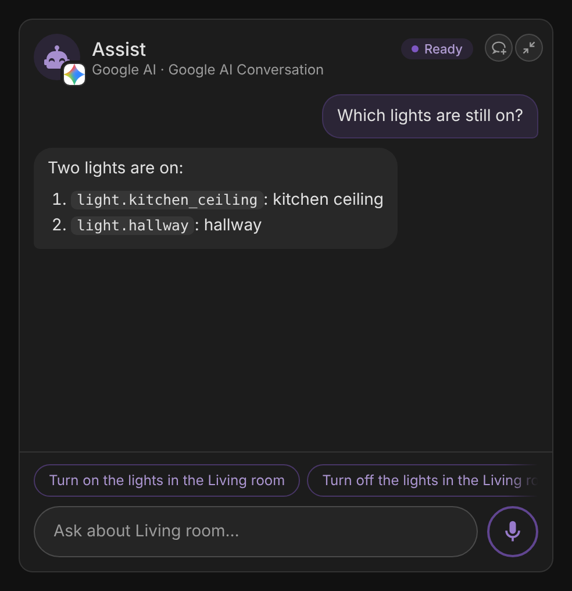 |

## How it works

A request goes through the `assist_pipeline/run` websocket subscription, from the `intent` stage to the `intent` stage (or to `tts` with `speak: true`), with the pipeline of the card and the conversation id of the previous answer. AI agents send their answer as `intent-progress` events (`chat_log_delta`): the card writes their text as it comes, one render per frame, and lists the tools they call; the final `intent-end` answer then replaces the streamed text and gives the conversation id for the follow-ups. The `tts-end` event gives the URL of the spoken answer, played in the browser.

With `agent_id`, the request goes through `conversation/process` to that agent instead (one answer, no streaming), and the spoken answer through a `tts`-only pipeline run.

The microphone records 16-bit mono PCM in the browser (an AudioWorklet, 16 kHz when the browser can) and streams it to an `stt`-only pipeline run over the websocket's binary messages; the pipeline's voice activity detection ends the recording when you stop speaking (or the button, or 15 seconds). The text it hears is then sent like a typed request, with the area for AI agents.

The conversation lives in the card: it is kept when the card leaves the page and comes back, and dropped by the new conversation button, a page reload or a change of pipeline or agent. The microphone is released and the speech stopped as soon as the card leaves the page.

## Development

```bash
npm install
npm run build        # bundles src/assist-card.js into dist/assist-card.js (translations split into dist/assist-card.i18n.*.js)
npm run check        # builds and checks the card (run in CI)
npm test             # unit tests (node --test)
npm run screenshots  # renders the cards (and one GIF per animation, needs ffmpeg) with a mock Home Assistant into screenshots/
```

`dist/` is not committed: `npm run build` creates it locally, CI builds it on every push, and the release workflow attaches the built files to the release, which is where the Marketplace installs it from. The **Screenshots** workflow re-renders the captures on every pull request that touches the card and commits them to the pull request's branch when a pixel changed.

### Releasing

1. Bump `version` in `package.json` (and `package-lock.json` with `npm install`)
2. Add a `## <version>` section at the top of [CHANGELOG.md](https://github.com/juju35/ha-assist-card/blob/main/CHANGELOG.md)
3. Push to `main`: the **Release** workflow builds the card, creates the tag and the GitHub release with the changelog section as notes, and attaches `assist-card.js` and its translation files

## Translations

The cards auto-detect the language from your Home Assistant settings. Currently supported:

| Language | Code |
|---|---|
| English | `en` |
| Français | `fr` |
| Deutsch | `de` |
| Español | `es` |
| Italiano | `it` |
| Nederlands | `nl` |
| Português (European; also used for `pt-BR`) | `pt` |
| Polski | `pl` |
| Српски | `sr` |
| Srpski (latinica) | `sr-Latn` |
| Română | `ro` |
| Dansk | `da` |
| Svenska | `sv` |
| Български | `bg` |
| Русский | `ru` |
| Українська | `uk` |
| Magyar | `hu` |
| Slovenčina | `sk` |
| Čeština | `cs` |
| Slovenščina | `sl` |
| Latviešu | `lv` |
| Ελληνικά | `el` |

Contributions for additional languages are welcome!

## Credits

The integration logos come from the [Home Assistant brands](https://github.com/home-assistant/brands) repository; Google, OpenAI, Anthropic and Ollama are trademarks of their owners. This project is not affiliated with any of them.

## License

[MIT](https://github.com/juju35/ha-assist-card/blob/main/LICENSE)

## Support

If you find this project useful, you can support its development:

<a href="https://buymeacoffee.com/julienstep9"></a>
